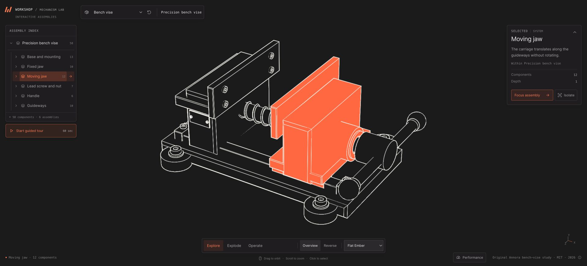

# Annora Explorer

A reusable, browser-based assembly Explorer. Select and isolate parts, follow
the component tree, explode and restore an assembly, switch between engineering
materials and crisp linework, or run an authored guided tour.

**[Live Explorer](https://kyle-annora.github.io/annora-explorer/)** ·
**[New-model example](https://kyle-annora.github.io/annora-explorer-bench-vise/)** ·
**[Create your project](https://github.com/new?template_name=annora-explorer&template_owner=kyle-annora)**

The starter includes Apollo and a moving crank mechanism. The bench-vise example
demonstrates a third, original model imported through the same pipeline. Brand,
model selection and feature availability are configured without modifying the
renderer. This is a static application: no backend, accounts or customer data.



## Start your own project

1. Choose **Use this template → Create a new repository** on GitHub. Use a public
   repository for GitHub Pages on a free personal account.
2. Clone your new repository. Install Node.js **22.12 or newer** and run:

   ```sh
   npm ci
   npm run dev
   ```

3. Open `http://127.0.0.1:8095/`. Edit `project.config.json` to change the brand,
   accent, default model and features. Restart the dev server after editing
   configuration or a model manifest.
4. Run `npm run verify`. In the new repository, set **Settings → Pages → Source →
   GitHub Actions**. Commit and push your changes. Run **Actions → Deploy Explorer
   → Run workflow** if creating the repository did not start a run. Later pushes
   to `main` deploy automatically after checks pass.

The published address is `https://<owner>.github.io/<repository>/`. The workflow
builds the site itself; do not commit `dist/`. See [deployment](docs/deployment.md)
for organization policies, CLI setup and troubleshooting.

## Bring a new model

The input is a self-contained, rigid **GLB** with uniquely named, untextured mesh nodes and one material per mesh.
CAD files need conversion and cleanup first. The importer prepares geometry,
compression and linework; it does not infer mechanical constraints, semantic
groups or a meaningful tour from arbitrary geometry.

Try the complete, included source example:

```sh
npm run import:model -- --source examples/bench-vise/model.glb --definition examples/bench-vise/import-definition.json --out content/models/my-vise
```

The example's model ID remains `bench-vise`; the output folder can differ. Add
`{"manifest":"content/models/my-vise/manifest.json"}` to `models` in
`project.config.json` and set `defaultModel` to `bench-vise`. Do not include two
packages with the same ID. The importer refuses to replace an existing folder.

For your own assembly, copy and adapt the definition in
[`examples/bench-vise/`](examples/bench-vise/), or follow the smaller example in
[model preparation](docs/models.md). Preserve source licenses and author any
operation clip and tour explicitly. Re-run `npm run verify` before publishing.

## Select the functions you need

`project.config.json` controls explosion, authored operation, tours, theme choices,
quality choices and available rendering styles. A disabled function is removed
from both the interface and the controller capability set. A tour that needs a
disabled function is disabled as well. See [configuration](docs/configuration.md).

Another website or tool can embed the Explorer and use the JSON controller to
select a part, frame a component, start a tour or save a compatible camera view.
The [integration example](examples/embed/) reads the configured model catalog and discovers runtime capabilities
instead of assuming particular component names. See [integration](docs/integration.md).

## Repository map

| Path | Responsibility |
| --- | --- |
| `project.config.json` | Project identity, brand, models and enabled features |
| `content/models/` | Prepared model packages, source credits and authored tours |
| `src/explorer/` | Shared UI, renderer, controller and player |
| `src/generated/` | Configuration output consumed by the build |
| `scripts/` | Configuration validation and deterministic asset preparation |
| `examples/bench-vise/` | Original source model, generator and onboarding definition |
| `examples/embed/` | A host that uses the public JSON API |
| `tests/` | Runtime, import, configuration and transport regressions |
| `.agents/skills/explorer-project/` | A task-scoped guide for AI-assisted onboarding |
| `docs/` | Contracts, decisions, deployment and evaluation |

Only models listed in the project configuration are included by the application
build. The source repository keeps the original examples as regression fixtures;
removing those source fixtures also requires updating their tests.

## Delivery documentation

- [Configuration](docs/configuration.md) and [model package contract](docs/models.md)
- [Host integration](docs/integration.md) and [API reference](docs/api.md)
- [Architecture](docs/architecture.md) and [decision record](docs/decisions.md)
- [Evaluation matrix](docs/evaluation.md) and [deployment](docs/deployment.md)
- [Licenses and third-party attribution](THIRD_PARTY_NOTICES.md)

The source runtime is MIT licensed. Each included model keeps its own license.
The public starter contains no customer website, private sales documents or
quotation data. Performance depends on asset complexity and device capabilities;
the lighter mechanism is the default, and the larger Apollo model loads only
when selected.
