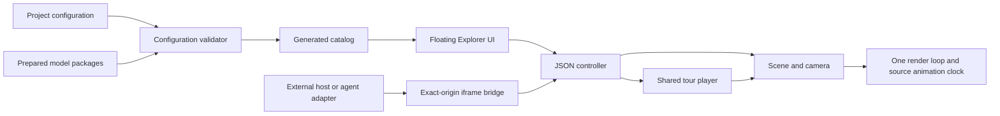

# Architecture

The project has three separate responsibilities: authored content, the shared
Explorer runtime, and an optional host that calls its public interface.

## Stable boundaries

- **Project:** identity, brand, default model, feature policy. No renderer changes
  are needed to add another prepared model.
- **Model package:** immutable source geometry, derived linework, stable component
  IDs, hierarchy, licenses, materials, separation offsets and an optional tour.
- **Controller:** JSON commands, capabilities, authoritative state, completion,
  interruption and disposal. It does not expose Three.js objects.
- **Scene:** rendering, picking, frame fitting, geometry loading and transitions.
  Existing engineering, hidden-line and flat-highlight treatments are retained.
- **Player:** authored absolute-time presentation. Camera, highlight, captions and
  source animation are sampled from one timeline. Pause and manual takeover are
  available throughout.
- **Host:** application-specific controls and data. It can use selected functions
  through the iframe client, without reaching into the embedded DOM.

The floating UI is still a full-document application. The supported embedding
boundary is one iframe; this release is not a same-document component SDK, an
npm package or an MCP server. An agent can prepare/publish a project with the
repository skill. Another agent tool can wrap the JSON API in its own browser
host; server-side 3D control is not included.

## Data and asset flow

`npm run prepare:project` validates the configured packages and generates literal
asset references for Vite. Content revisions include the manifest, source and
derived bytes, license, presentation policy and tour. Camera bookmarks are
revision-scoped; geometry changes invalidate them instead of silently remapping
parts by title. Only configured model assets enter the application build.

Prepared binary linework is mesh-local. Source node transforms and animation
remain authoritative. Exploded offsets are explanatory and are never combined
with an operating pose. Neither import nor playback solves mechanical physics.

## Harness and evaluations

The delivery loop is: read the decision record → identify the public boundary →
change configuration/content first → validate → inspect desktop and mobile →
review the publishable artifact → deploy → verify the deployed revision. Use
`docs/evaluation.md` to record what was actually observed. A green unit suite is
not evidence of visual fidelity or performance on an untested device.

For runtime changes, keep tests against the original model fixtures. For new
content, use the generic pipeline and a separate project configuration. Update
contracts and regression cases when behavior changes; do not hide deviations
with model-specific conditions in the renderer.
