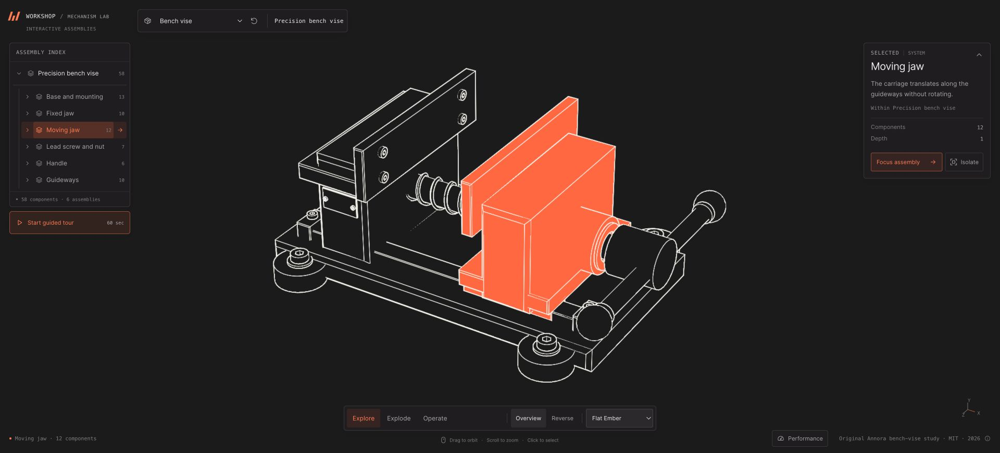

# Workshop proof-project review

[Open the live Explorer](https://kyle-annora.github.io/annora-explorer-bench-vise/) · [Open the supplied host](https://kyle-annora.github.io/annora-explorer-bench-vise/examples/embed/)

## GitHub template provenance

GitHub generated `kyle-annora/annora-explorer-bench-vise` from `kyle-annora/annora-explorer`; the repository API confirms that relationship. The initial generated commit is `dd22cdf3efa135efee1216f964675f9376b1bc0a`, from template commit `889ded549867540fa45abe95e631acd0b1ea0cb4`.

This proof used a fresh clone of the generated GitHub repository, following its English README, AGENTS, repository skill and linked guides. It did not reuse the earlier local onboarding copy.

## What changed

The project configuration defines `workshop-vise`, `WORKSHOP / MECHANISM LAB`, Ember, and one newly imported package at `content/models/my-vise`. Themes are disabled; quality controls, three rendering styles, explosion, authored operation and the guided tour remain enabled.

The original sample was imported through the generic CLI. No file under `src/explorer/` changed. Catalog and project modules were generated by the normal preparation command. The source, MIT license, import definition, tour and preparation report are retained. The [machine-readable evidence](onboarding-evidence.json) records configuration, source and shared-runtime hashes.

## Build and deployment

- `npm ci` succeeded with zero reported vulnerabilities.
- Generic import completed without warnings: **58 meshes, 12,174 triangles, 29 unique geometries**.
- Source SHA-256: `40427624bc9844818508fa07bef612154d44ae92880f717c557caa81468fe623`.
- `npm run verify` passed package validation, **247 tests**, and the production build locally on Node v26.3.0.
- [GitHub Actions run 41256328703](https://github.com/kyle-annora/annora-explorer-bench-vise/actions/runs/41256328703) independently passed the same 247 tests and build on Node v22.23.4, then deployed application commit `37ac8c8d435299f8e4199fae44fc1cb1696b0042`.
- The source GLB is 848,488 bytes; its prepared gzip is 141,781 bytes. The production build contains one configured model package.

## Recorded live review

Chrome UI checks ran against the deployed application on 2026-11-01 UTC. Screenshot bytes are preserved without visual editing; artifact hashes are in the evidence JSON.

| Area | Recorded result |
| --- | --- |
| Brand and capabilities | WORKSHOP / MECHANISM LAB, one Bench vise model, Ember; theme picker absent and quality controls present. |
| Rendering | Engineering, pure linework and Flat Ember displayed on the live model. |
| Hierarchy and assembly | Selected and focused Moving jaw, inspected its children, isolated it, exploded to 100%, and restored the assembly. |
| Operation | Manual cycle reached completion; seeking to 45% produced a paused pose. |
| Full guided tour | One uninterrupted, unseeked 60-second run completed at 390×844. Replay and Explore completion controls appeared. |
| Tour restoration | Returning restored the preceding Engineering / Operate / paused 45% view. |
| Takeover and chapters | Dragging the model paused the tour. Chapter navigation reached Motion, its short caption and rotary-input highlight. |
| Responsive layout | Standalone 390×844 and 844×390 layouts had no document overflow; the landscape player and model remained usable. These are browser viewport checks. |
| Browser diagnostics | No application console errors or warnings recorded; two unrelated browser-extension warnings were excluded. |

[Engineering](evidence/desktop-engineering.jpg) · [Pure linework](evidence/desktop-linework.jpg) · [Exploded](evidence/desktop-exploded.jpg) · [Mobile operation](evidence/mobile-operation.jpg) · [Mobile tour](evidence/mobile-tour.jpg) · [Completed tour](evidence/mobile-tour-completed.jpg) · [Landscape tour](evidence/landscape-tour.jpg)

## Separate-origin integration

The unchanged supplied host was served at `http://127.0.0.1:8121`; its iframe loaded the deployed Explorer at `https://kyle-annora.github.io`. The child URL supplied the exact parent origin. The visible model, Connected status, host controls and state updates were inspected together.

Host commands selected/focused Moving jaw, switched to Flat, and changed explosion to 65%. A [captured JSON bookmark](evidence/host-bookmark.json) restored the previous scope, render style and zero separation. A deliberately different model revision was rejected without changing the view. Host tour controls started, sought Motion, resumed, paused and exited, restoring the prior view.

Disconnect removed the iframe and disabled controls. Connect and another Remount produced fresh ready scenes. A normal page reload also connected directly. The first opening had been observed in Connecting state and manually remounted before load timing was recorded; that observation does not establish a reproducible timeout or a measured cold-load result.

At a 390×844 viewport, selecting a chapter from host controls revealed the rendered iframe and paused Motion chapter. The content width was 375 pixels with the vertical scrollbar; there was no horizontal overflow.

[Desktop host and exact origins](evidence/cross-origin-host.jpg) · [Mobile host command result](evidence/cross-origin-host-mobile.jpg)

## Limits

The model is an original MIT-licensed illustrative assembly. Its authored screw-to-jaw relation does not establish collision/contact, clamping force or manufacturability. The importer accepts prepared rigid, untextured GLB, with deliberately authored semantics and motion.

The public boundary is a versioned iframe/JSON interface, not a same-document SDK or remote MCP service. No backend is included. Physical-phone and ordinary-laptop GPU/thermal qualification, measured cold-network loading and multi-instance rendering capacity remain open. Viewport checks and passing deterministic tests are not those hardware results.
